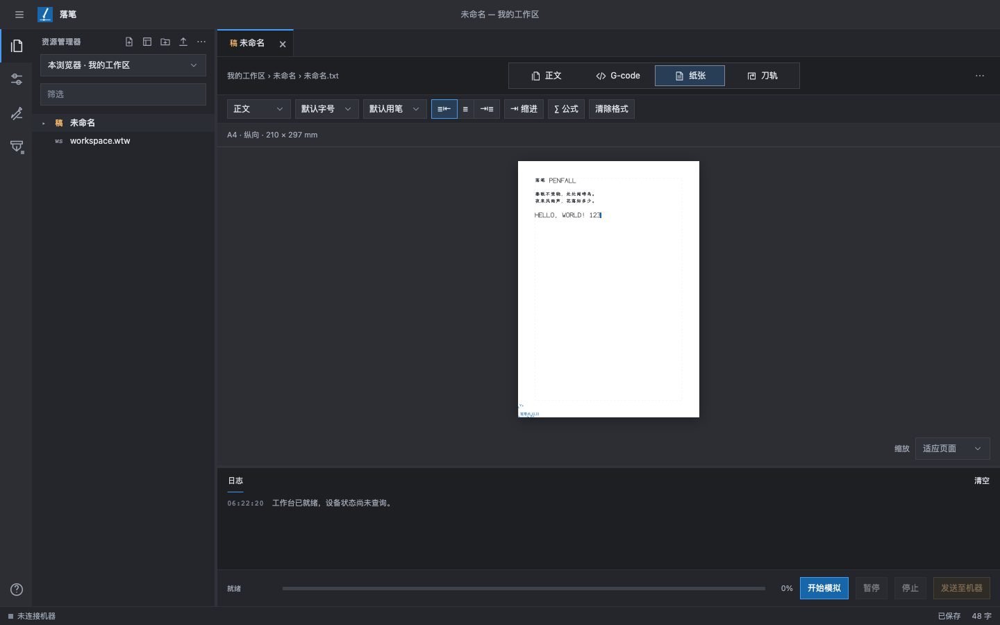
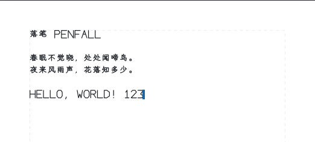
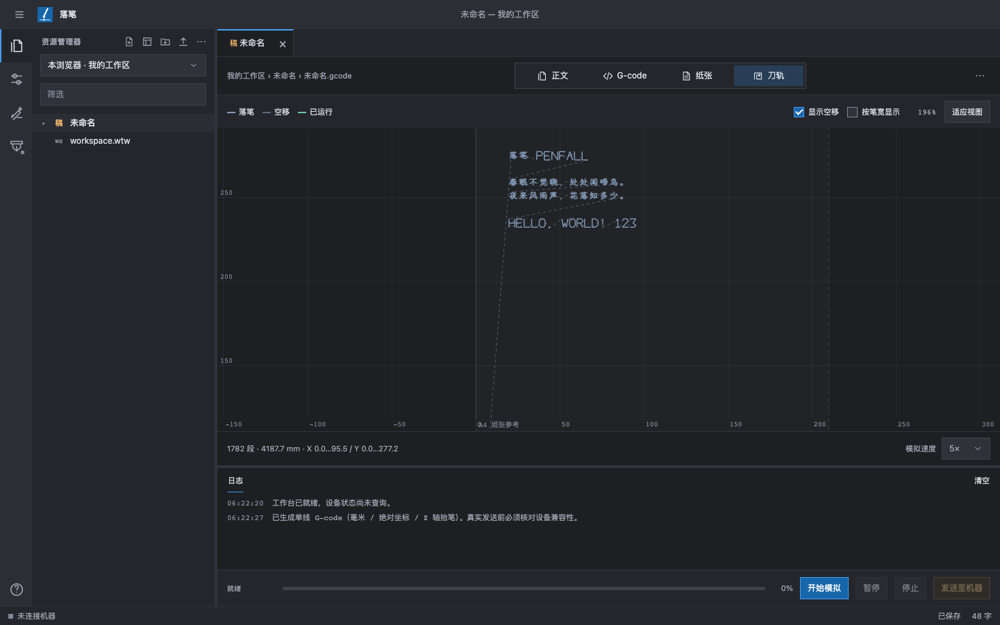
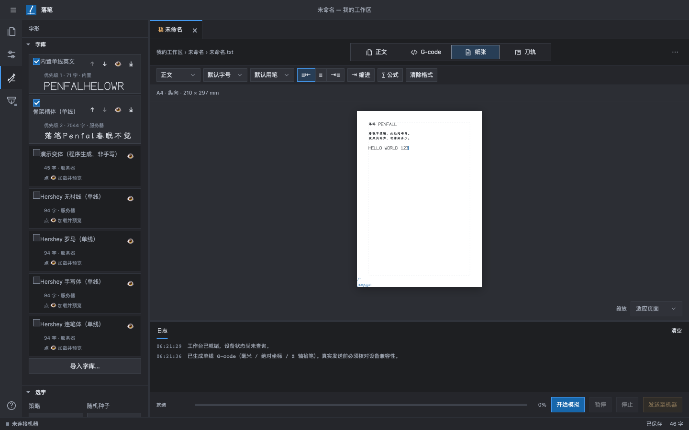

<p align="center"></p>

<h1 align="center">落笔 Penfall</h1>

<p align="center">单线写字机的 Web 工作台 —— 写稿、排版、生成 G-code、模拟，再发送给 GRBL 写字机。</p>



> ⚠️ 目前只支持**标准 GRBL 1.1** 和 **Grbl_Esp32 1.3a**（Z 轴抬笔，或主轴 PWM 驱动的舵机抬笔），还没有在任何品牌写字机上实测过。连接真机前，请先用模拟功能检查。

## ✨ 功能一览

| | |
|---|---|
|  | **纸面编辑（像 Word 一样）**<br>纸面上看到的就是真实的单线笔迹。支持中英文混排、标题、字号、对齐、LaTeX 公式和导入 Word 文件。 |
|  | **G-code 与刀轨模拟**<br>一键生成单线 G-code，可以看到落笔线和空移线，能缩放和平移，支持逐行模拟。 |
|  | **单线字库**<br>自带内置英文字库、4 款 Hershey 字体和「骨架楷体」（覆盖 GB2312 的 6763 个汉字）。每个字都能单独选写法。 |

**其他功能：** 运笔（起笔、行笔、转折、收笔的速度与笔压变化，Z 轴弹簧笔架可边写边压）· 拟真笔迹（大小 / 倾斜 / 基线 / 字距变化与连笔，可复现）· 下划线、删除线、上下标、列表、行距、格式刷 · Z 轴或舵机抬笔与机型预设 · 预计书写时间 · VS Code 式文件管理 · 自动保存 · 模板与格子背景（田字格、米字格、作文稿纸等）· 导入 SVG / DXF 图形 · 多色换笔 · 多页与双面书写 · 局域网 USB 桥接

## 🚀 快速开始

```sh
python3 -m venv .venv
.venv/bin/python -m pip install -r requirements.txt
.venv/bin/python server.py --host 0.0.0.0 --port 5173
```

<details><summary>Windows</summary>

```powershell
python -m venv .venv
.venv\Scripts\python.exe -m pip install -r requirements.txt
.venv\Scripts\python.exe server.py --host 0.0.0.0 --port 5173
```
</details>

打开 <http://localhost:5173>，在正文中输入文字，然后切换到「纸张」或「刀轨」查看效果，点击 **开始模拟**。

- 局域网中的设备可以访问 `http://电脑IP:5173`。连接时要输入终端里显示的**访问密钥**。
- USB 写字机要插在运行 `server.py` 的电脑上。

## 🔌 连接写字机

1. 打开「机器 › 机型」：选一个最接近的预设并应用（Z 轴或舵机），然后按你的机器调整数值。
2. 打开「机器 › 连接」：输入密钥，选择串口和波特率，然后连接。
3. 打开「机器 › 位置」：把笔移到纸张原点，然后把 XY 设为零。
4. 打开「机器 › 行程与安全」：核对行程，勾选安全确认。
5. 点击 **发送至机器**。

> 「停止」只是软复位，**不能代替物理急停**。关闭网页后，机器上的任务不会自动停止。

## 📚 文档

- [完整使用手册](docs/guide.md)：所有功能、边界说明、安全说明、代码结构和测试
- [工作区格式](docs/workspace-format.md) · [字形库格式](docs/glyph-format.md) · [坐标系说明](docs/coordinate-system-review.md)

## 🧪 测试

```sh
node --test tests/*.test.js
.venv/bin/python -m unittest discover -s tests -p 'test_*.py'
```

## 许可

代码采用 [MIT](LICENSE) 许可。字库沿用各自的许可：骨架楷体为 SIL OFL 1.1，Hershey 字体须保留致谢。详见 `web/glyphs/*NOTICE.txt`。
